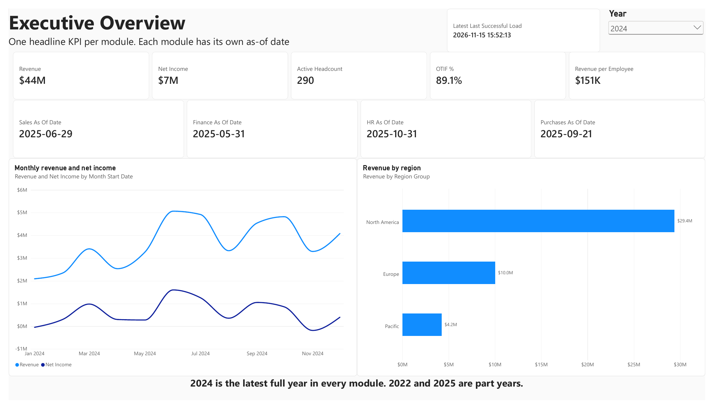

# Enterprise BI Suite

One reporting system for a multi-region company. It combines sales, finance, HR and supply chain data in a SQL Server data warehouse, and serves it to a Power BI report in which each user sees only their own region.

Source data: Microsoft's sample databases AdventureWorks2025 (sales, HR, purchasing, production) and AdventureWorksDW2025 (finance).



---

## What it does

- **One warehouse, four modules.** A nightly pipeline copies the needed source tables, builds a star schema (7 facts, 17 dimensions) and runs 27 data quality checks. It is all or nothing: if a check fails, the whole run is rolled back.
- **One report, seven pages.** Executive Overview, Sales, Finance, HR, Purchasing & Inventory, Production and Data Quality. They are built for 32 agreed business questions. Every Must question is answered; the Should questions not shown are listed in the report guide.
- **Security by region.** One dynamic role reads the signed-in user's email:
  - executives see everything;
  - regional managers see their own region's sales and finance, plus company-wide stock;
  - anyone else sees nothing.
- **Tested and documented.** Every warehouse table and every report figure is checked against SQL, and every design choice is recorded with its reason and evidence.

## Architecture

```mermaid
flowchart LR
    subgraph SRC["Sources (read-only)"]
        OLTP[("AdventureWorks2025")]
        DWS[("AdventureWorksDW2025")]
    end
    subgraph WH["EnterpriseBI_DW (SQL Server 2025)"]
        STG["stg: copies of needed columns"]
        DW["dw: 7 facts, 17 dimensions"]
        ETL["etl: load log and quality checks"]
    end
    JOB{{"SQL Server Agent job<br/>nightly 02:00"}}
    PBI["Power BI Desktop<br/>Power Query, DAX,<br/>row-level security"]
    OLTP --> STG
    DWS --> STG
    STG --> DW
    JOB -. runs etl.run_pipeline .-> STG
    DW --> PBI
    ETL --> PBI
```

| Layer | Role |
|---|---|
| Sources | The company's systems; never changed by the pipeline |
| `stg` | Plain copy of the tables and columns in use (36 tables) |
| `dw` | Star schema with all business rules: keys, date shifts, costs, currency conversion |
| `etl` | One row per run, per step and per data quality check |
| Power BI | Business names, relationships, 90 DAX measures, row-level security |

**Scheduler.** The job runs one stored procedure, `etl.run_pipeline`. Any scheduler can call the same procedure. The brief lists Azure Data Factory; it is not used here, because the SQL Server Agent job does the same work at no cost, and an Azure Data Factory pipeline could call the same procedure without changes (decision D09).

**Power BI Desktop only.** The report is delivered in Power BI Desktop with a recorded demo; the Power BI Service is not used, as agreed with the Nexvia technical team (D11).

Full details: [`docs/design/architecture.md`](docs/design/architecture.md).

---

## Repository layout

```
DA-01/
├── README.md
├── sql/
│   ├── 00_source_profiling/   profiling queries run on the sources
│   ├── 01_design_checks/      checks that fixed the design of each table
│   └── 02_warehouse/          01 to 32: database, staging, dimensions, facts, pipeline, Agent job
├── tests/                     test scripts for each build stage, with expected results
├── powerbi/
│   ├── EnterpriseBI_Suite.pbip               open this in Power BI Desktop
│   ├── EnterpriseBI_Suite.SemanticModel/     model in TMDL, DAX test queries
│   └── EnterpriseBI_Suite.Report/            7 report pages
└── docs/
    ├── report_guide.md        the pages, the figures checked and the security tests, with screenshots
    ├── test_results.md        results of every test (B1 to B7)
    ├── source_inventory.xlsx  source tables and columns used
    ├── screenshots/
    └── design/
        ├── business_questions.md   the 32 questions the report answers
        ├── architecture.md         layers, load process, quality checks, security
        ├── data_model.md           facts, dimensions and their grain
        ├── decision_log.md         every decision with its reason and evidence (D01-D139)
        └── limitations.md          known limits of the data and the solution
```

---

## Setup

### Prerequisites

| Tool | Version used |
|---|---|
| SQL Server with SQL Server Agent | 2025 Enterprise Developer (17.0.1155.3) |
| SQL Server Management Studio | 22 |
| Power BI Desktop | 2.159.1231.0, 64-bit (October 2026) |

The report is saved as a Power BI Project (`.pbip`). Power BI Desktop marks this format as preview; if it is switched off, turn it on under File → Options and settings → Options → Preview features.

### 1. Restore the sources

Restore `AdventureWorks2025` and `AdventureWorksDW2025` from Microsoft's AdventureWorks sample backups to the same SQL Server instance, keeping those database names.

### 2. Build the warehouse

In SSMS, open and run the scripts in `sql/02_warehouse/` in number order, from `01_create_database.sql` to `32_agent_job.sql`.

- Every script is safe to run again.
- Script 30 creates the four demo users for the security role.
- Script 32 creates the Agent job **EnterpriseBI_DW nightly load**, which runs daily at 02:00.

### 3. Run the first load

Either run this in SSMS:

```sql
USE EnterpriseBI_DW;
EXEC etl.run_pipeline;
```

or start the Agent job: SQL Server Agent → Jobs → EnterpriseBI_DW nightly load → Start Job at Step.

Check that the run succeeded:

```sql
SELECT TOP (1) batch_id, started_at, ended_at, status
FROM etl.load_batch
ORDER BY batch_id DESC;
```

`status` should be `Succeeded`. `etl.load_log` holds each step and `etl.dq_result` each quality check.

### 4. Open the report

1. Open `powerbi/EnterpriseBI_Suite.pbip` in Power BI Desktop.
2. Click **Home → Refresh**. The report connects to `localhost`, database `EnterpriseBI_DW`, with Windows sign-in, in Import mode (D121).
3. If Power BI asks about encryption, choose to connect without it. The local SQL Server uses a self-signed certificate (see `docs/design/limitations.md`).

### 5. Try the security

Go to **Modeling → View as**, tick **Other user**, enter one of the users below, tick the role **Dynamic Security**, and click OK.

| User | Access |
|---|---|
| `ken0@adventure-works.com` | Executive: everything |
| `stephen0@adventure-works.com` | Regional manager, North America |
| `syed0@adventure-works.com` | Regional manager, Pacific |
| `amy0@adventure-works.com` | Regional manager, Europe |
| any other email | No data |

The expected results for each user are in [`docs/report_guide.md`](docs/report_guide.md#10-security-by-region).

### 6. Run the tests (optional)

- **Warehouse:** the scripts in `tests/` check each build stage. Each script states its expected results.
- **Model:** the DAX queries in `powerbi/EnterpriseBI_Suite.SemanticModel/DAXQueries/` check the model against SQL. Open them in Power BI Desktop's DAX query view.

All recorded results are in [`docs/test_results.md`](docs/test_results.md).

---

## The report

| Page | Answers |
|---|---|
| Executive Overview | One headline KPI per module, each with its own as-of date |
| Sales | Revenue and growth, regions, channels, categories, salespeople against quota |
| Finance | Income statement, margins, budget vs actual, balance sheet, current ratio |
| HR (executives) | Headcount, workforce make-up, hiring, tenure, pay and leave |
| Purchasing & Inventory | Spend, vendor quality, order status, stock and what to reorder |
| Production (executives) | Work orders, scrap and on-time completion |
| Data Quality (executives) | Pipeline runs and the checks of the latest load |

Each module ends on its own date, so each page shows its own "data as of" date. The report opens on 2024, the latest full year in every module. Page-by-page details: [`docs/report_guide.md`](docs/report_guide.md).

## Limitations

The main ones are listed below; the full list is in [`docs/design/limitations.md`](docs/design/limitations.md).

- Row-level security protects the data when the report is shared through the Power BI Service. The `.pbix` / `.pbip` files themselves are not protected; security is shown with "View as".
- Power BI has no page-level security. Pages for executives are visible to every user, but their figures are hidden and a message is shown.
- The scheduled job runs on a laptop, so a run that falls due while the laptop sleeps starts when it wakes.
- Facts are fully reloaded on every run, which takes seconds at this size; incremental loading is a documented next step.
