# Report Guide: Enterprise BI Suite

This guide describes the seven pages of the Power BI report, the questions each page answers, how the region security behaves, and the figures that were checked against SQL Server. The screenshots were exported from Power BI Desktop on 17 Nov 2026, from the data loaded by batch 5082 (15 Nov 2026), with the Year slicer at 2024.

Decision numbers (D..) refer to `design/decision_log.md`. Question codes (S1, F2, ...) refer to `design/business_questions.md`.

---

## 1. Opening and refreshing the report

1. Open `powerbi/EnterpriseBI_Suite.pbip` in Power BI Desktop (version 2.159 or later).
2. Click **Home → Refresh**. The report reads the `EnterpriseBI_DW` database on `localhost` in Import mode (D121).
3. Check the **Last data load** card at the top of each page. It shows when the last successful pipeline run finished.

## 2. Layout used on every page

| Element | Purpose |
|---|---|
| Page title and subtitle | Says what the page covers and the module's own "data as of" date (D24) |
| Last data load card | End time of the last successful pipeline run (`etl.load_batch`) |
| Year slicer | Filters the page by calendar year. The report opens on 2024, the latest full year in every module; 2022 and 2025 are part years |
| Restricted message card | On executive-only pages, shows a message to users who may not see the data. Empty for executives (section 10) |
| KPI cards | Headline figures for the selected year |
| Charts and tables | Trend, breakdown and detail |

Clicking a bar or a table row filters the rest of the page. Click it again to clear the selection.

---

## 3. Executive Overview

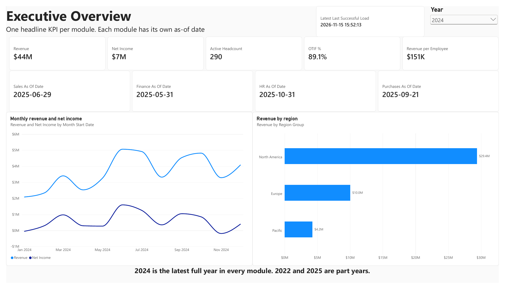

**Answers:** E (how is the company doing at a glance).

| Visual | Content |
|---|---|
| KPI cards | Revenue, Net Income, Active Headcount, OTIF %, Revenue per Employee |
| As-of dates | Last data date of sales, finance, HR and purchases. The modules end on different dates (D24) |
| Monthly revenue and net income | Line chart by month |
| Revenue by region | Revenue by region group |

**Checked (2024):**
- Revenue: $43,671,889.50, the same as SQL on `dw.fact_sales`.
- Active Headcount: 290, the same as SQL at the December 2024 month-end.
- Net Income: $7,119,747.65 (B6 test 6).

---

## 4. Sales

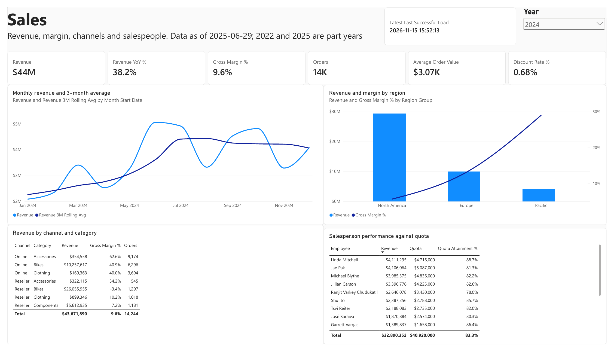

**Answers:** S1, S2, S3, S4, S5, S6, S8 (discount rate), S9.

| Visual | Content |
|---|---|
| KPI cards | Revenue, Revenue YoY %, Gross Margin %, Orders, Average Order Value, Discount Rate % |
| Monthly revenue and 3-month average | Revenue trend with its 3-month rolling average |
| Revenue and margin by region | Revenue (columns) and gross margin % (line) by region group |
| Revenue by channel and category | Online and reseller, by product category |
| Salesperson performance against quota | Reseller revenue, quota and attainment per salesperson. Visual filter: salespeople only |

**Checked (2024):**
- The channel table total, $43,671,890, matches the Revenue card and SQL.
- The salesperson total, $32,890,352, equals the sum of the four reseller rows in the channel table. Quota is $40,920,000, and attainment is 83.3%.

**Note:** reseller bikes show a negative margin in 2024 (−3.4%). This comes from the source costs (D26).

---

## 5. Finance

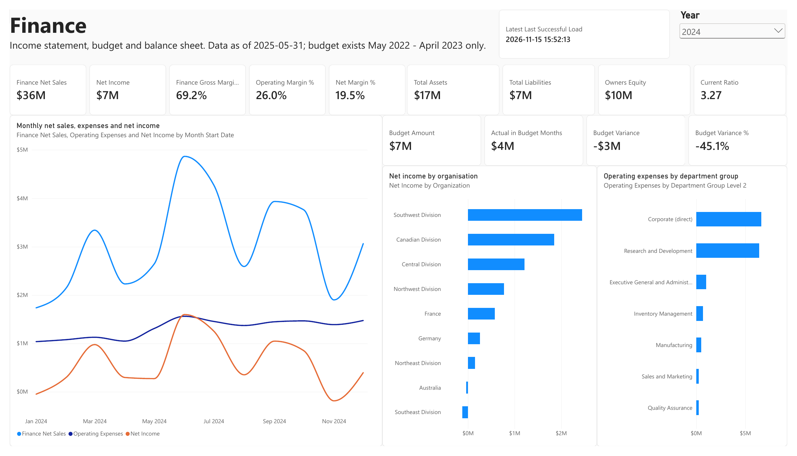

**Answers:** F1, F2, F3, F4, F5, F6 (year-end position).

| Visual | Content |
|---|---|
| KPI cards | Finance Net Sales, Net Income, gross, operating and net margin %, Total Assets, Total Liabilities, Owners Equity, Current Ratio |
| Monthly net sales, expenses and net income | Line chart by month |
| Current ratio by month | Company current ratio by month; click an organisation in the net income chart to see that organisation's ratio (D139) |
| Budget vs actual | Budget, actual in budget months, variance and variance %. The Year slicer does not filter this card, because the budget exists only for May 2022 to April 2023 |
| Net income by organisation | By organisation unit |
| Operating expenses by department group | By department group, level 2 |

**Checked:**
- 2024: net sales $36,494,147.33, net income $7,119,747.65, margins 69.2 / 26.0 / 19.5% (B6 test 6).
- Budget: $7.43M budget, $4.08M actual, −$3.35M variance, −45.1% (B6 test 6).
- 2025 balance sheet: assets $19,134,799.60, liabilities $7,383,993.53, equity $11,750,806.07, current ratio 3.57 (B6 test 6, D115).
- The balance sheet cards show the closing position at the last month of the selected year.
- Current ratio chart, December 2024: 3.27 for the company and 4.59 for Southwest Division, the same as the card.

---

## 6. HR (executives only)

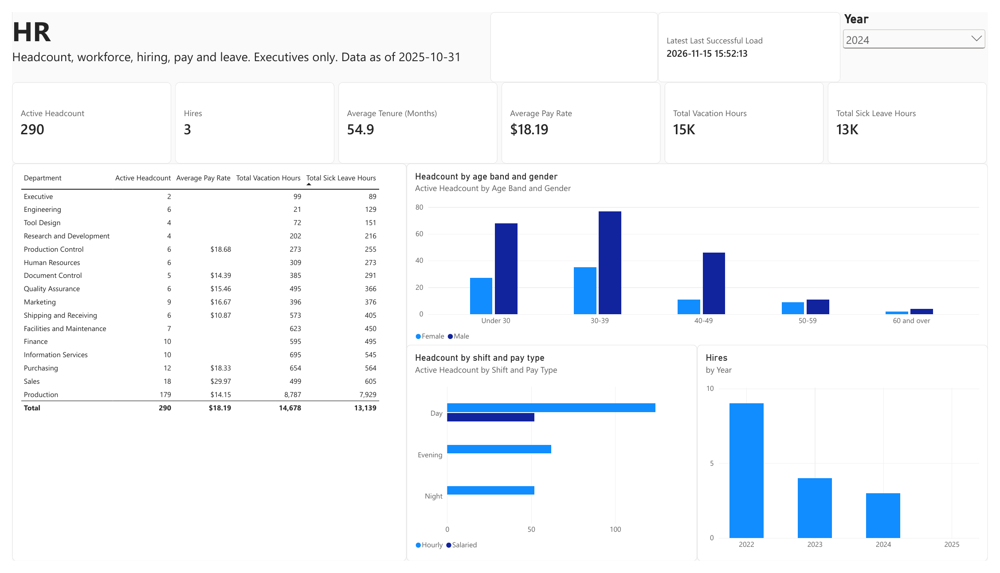

**Answers:** H1, H2, H3, H4, H5.

| Visual | Content |
|---|---|
| KPI cards | Active Headcount, Hires, Average Tenure (Months), Average Pay Rate, Total Vacation Hours, Total Sick Leave Hours |
| Department table | Headcount, average pay rate and leave hours by department |
| Headcount by age band and gender | Age bands in order (sort key built in Power Query) |
| Headcount by shift and pay type | Hourly and salaried by shift |
| Hires by year | All years. The Year slicer does not filter this chart |

**Checked:**
- 2024: headcount 290, 3 hires, tenure 54.9 months.
- 2025: headcount 290, 0 hires, tenure 64.9 months.
- Hires by year add up to 16 (B4 test 3).

**Notes:**
- Average Pay Rate is blank for departments with fewer than 5 people, to avoid revealing individual pay (D64).
- The age band is the employee's age on 2025-10-31, so the age chart does not change with the Year slicer.

---

## 7. Purchasing & Inventory

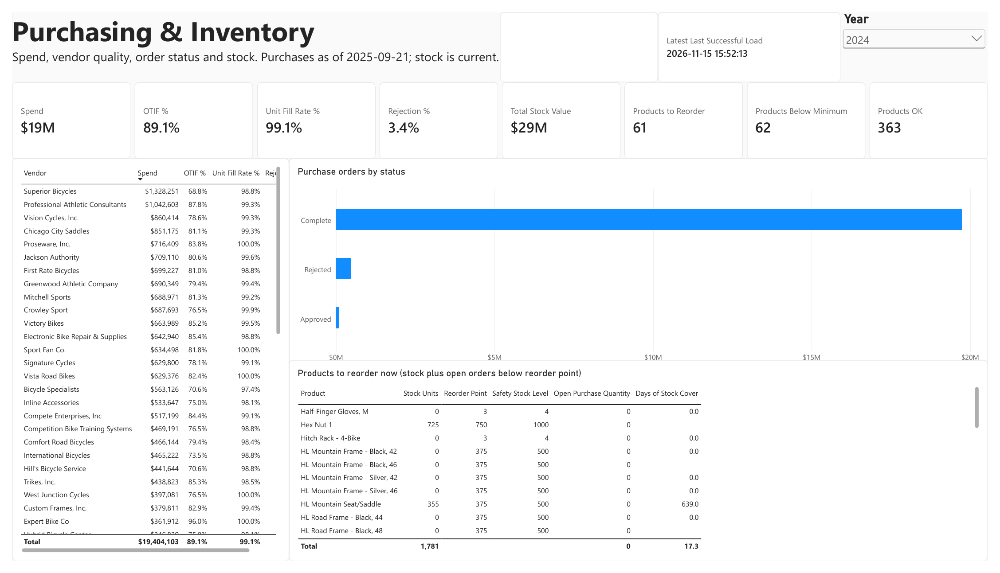

**Answers:** P1, P2, P3, P4, P8, P9.

| Visual | Content |
|---|---|
| KPI cards | Spend, OTIF %, Unit Fill Rate %, Rejection %, Total Stock Value, Products to Reorder, Products Below Minimum, Products OK |
| Spend and quality by vendor | Spend, OTIF, fill rate and rejection per vendor |
| Spend by product category | Spend by product category (D139) |
| Purchase orders by status | Order value by status, with the order count as a tooltip |
| Products to reorder now | Products whose stock plus open purchase orders is below the reorder point, with days of stock cover |

**Checked:**
- 2024 spend: $19,404,103 (vendor table total).
- Stock (current position, not filtered by the Year slicer): $28,522,266.13; 61 to reorder, 62 below minimum, 363 OK (B6 test 8).
- Purchase orders run to 2025-09-21. Deliveries were due to 2025-10-21 and shipped to 2025-10-16.

**Days of stock cover** = stock on hand ÷ average daily units sold over the last 90 days of sales. The 90-day demand is stored in a hidden table, `Product Demand 90d`, calculated at refresh. Because of that, region security does not reduce it, and every user sees the same company-wide cover (D136, section 10).

---

## 8. Production (executives only)

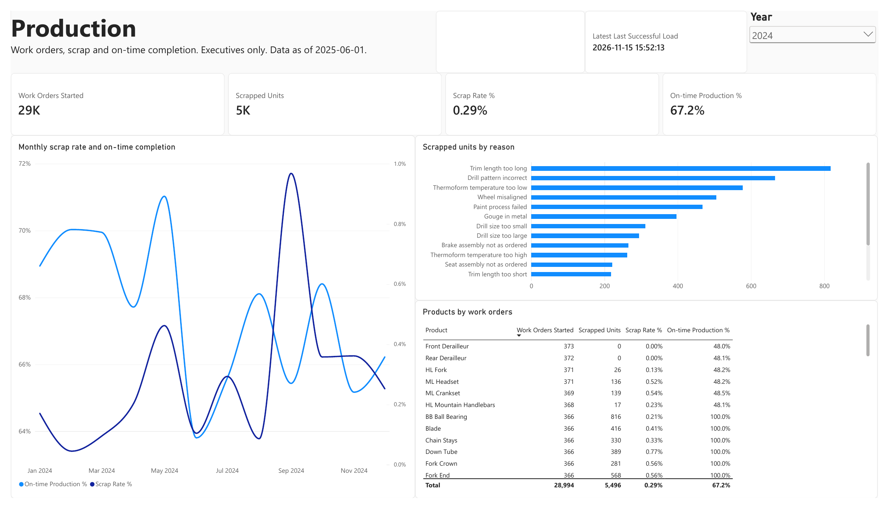

**Answers:** P6, P7.

| Visual | Content |
|---|---|
| KPI cards | Work Orders Started, Scrapped Units, Scrap Rate %, On-time Production % |
| Monthly scrap rate and on-time completion | Scrap rate on the right axis, on-time % on the left |
| Scrapped units by reason | By scrap reason |
| Products by work orders | Work orders, scrap and on-time % per product |

**Checked (2024):** the table total of 28,994 work orders, 5,496 scrapped units, 0.29% scrap and 67.2% on time matches the KPI cards. All years: 72,591 work orders, 0.24% scrap, 68.6% on time (B6 test 8).

**Note:** scrap cost is not shown, because only 21.4% of scrapped units have a cost in the source (D46).

---

## 9. Data Quality (executives only)

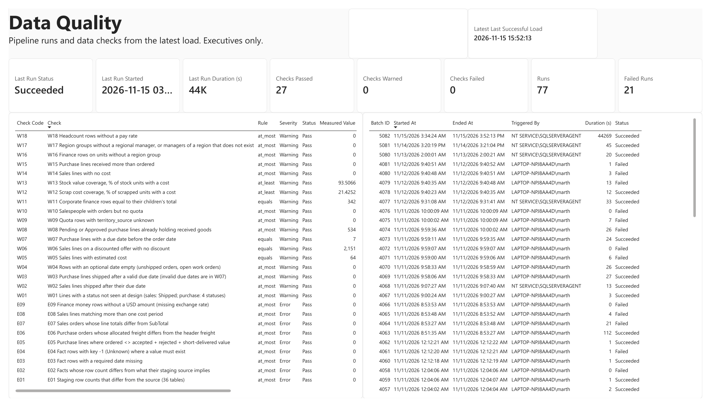

| Visual | Content |
|---|---|
| KPI cards | Last run status, start and duration; checks passed, warned and failed in the latest run; total and failed runs |
| Checks in the latest load | The 27 checks of the latest run with results (18 warning rules W01–W18, 9 error rules E01–E09) |
| Pipeline run history | Every pipeline run, newest first, with its status |

This page has no Year slicer, because the data quality tables have no date relationship.

**Checked:** succeeded, 27 passed, 0 warned, 0 failed, 77 runs, 21 failed runs, the same as `etl.dq_result` and `etl.load_batch`.

**Note:** batch 5082 took 44,269 s because the laptop slept during the run. The load itself took about 22 seconds (`design/limitations.md`).

---

## 10. Security by region

Every user is matched by email (`USERPRINCIPALNAME()`) to the table `Security User Region` through one role, **Dynamic Security** (D71–D73, D132).

| User type | Sales and finance | HR, purchasing, production, data quality | Inventory |
|---|---|---|---|
| Executive | All regions | Visible | Visible |
| Regional manager | Own region group only | Hidden, with a message | Visible (company-wide) |
| Email not in the table | Nothing | Nothing | Nothing |

Power BI has no page-level security. The pages restricted to executives show a message card, and row-level security hides the data (D134).

**Tested in Power BI Desktop with Modeling → View as** (17 Nov 2026):

| User | Page | Result |
|---|---|---|
| stephen0 (North America) | Executive Overview | Revenue $29M and region chart North America only; headcount, OTIF, revenue per employee, HR and purchases as-of dates blank |
| stephen0 | HR | Message shown, every visual blank |
| stephen0 | Purchasing & Inventory | Purchasing message; spend, vendor table and order status blank; stock $29M and 61 / 62 / 363 as for executives; days of stock cover 639.0 for HL Mountain Seat/Saddle and 17.3 in total, the same as for executives |
| ken0 (Executive) | HR | All data, no message |
| nobody@example.com | HR, Purchasing & Inventory | Message shown, every value blank. The three product count cards show 0, as their measures add 0; no product data is shown |

**Stephen, Executive Overview**

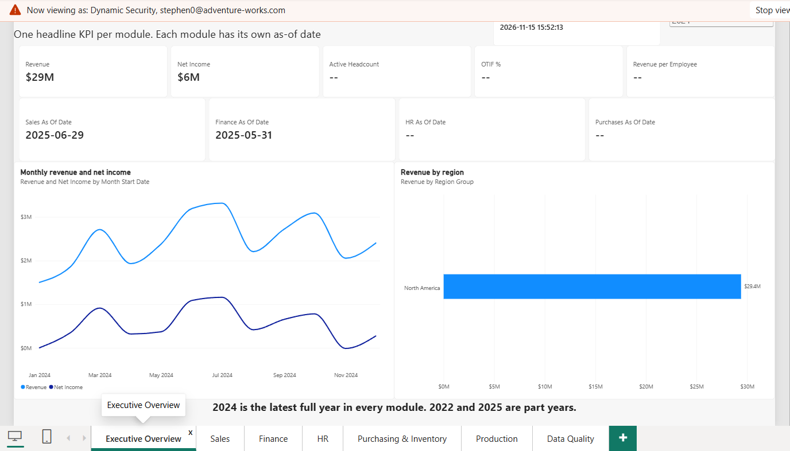

**Stephen, HR**

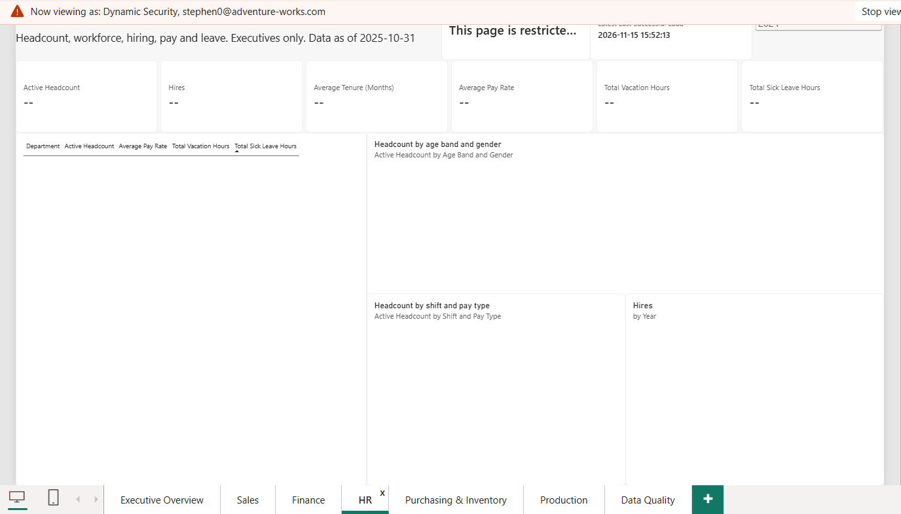

**Stephen, Purchasing & Inventory**

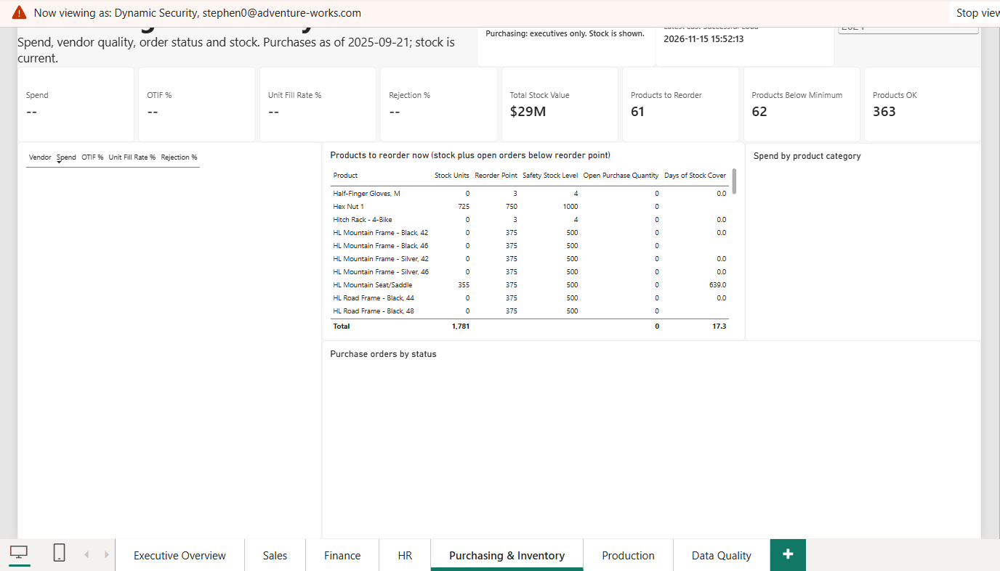

**Ken, HR**

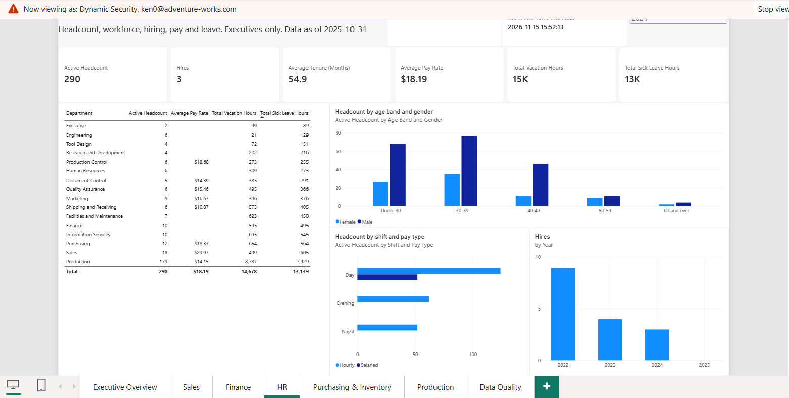

**Unknown user, HR**

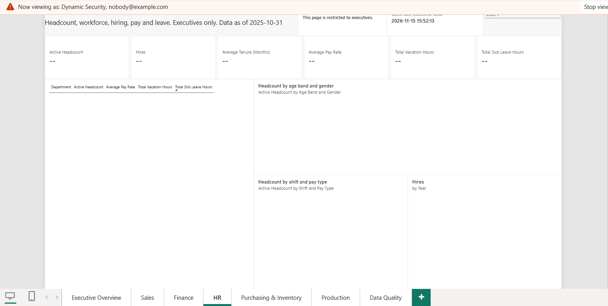

**Unknown user, Purchasing & Inventory**

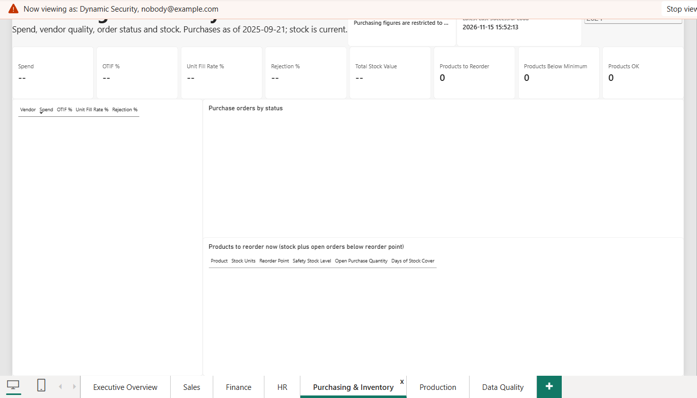

---

## 11. Questions not shown on the report pages

All Must questions are on the pages. These Should questions are not, or only in part:

| Question | Priority | Status |
|---|---|---|
| S7 Shipping on time | Should | Not built |
| S8 Discount by offer | Should | Only the overall discount rate is shown |
| F6 Balance sheet by month | Should | The cards show the year-end position |
| F7 Local currency | Should | Not built (D37) |
| F8 Finance vs sales comparison | Should | Not built |
| P5 Stock trend | Should | Not built (D49) |
