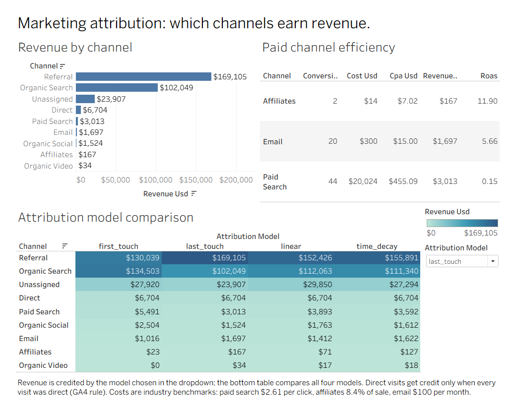
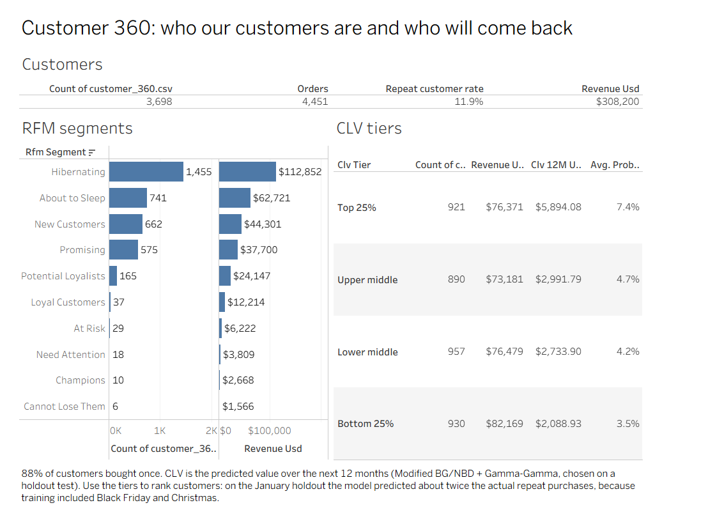
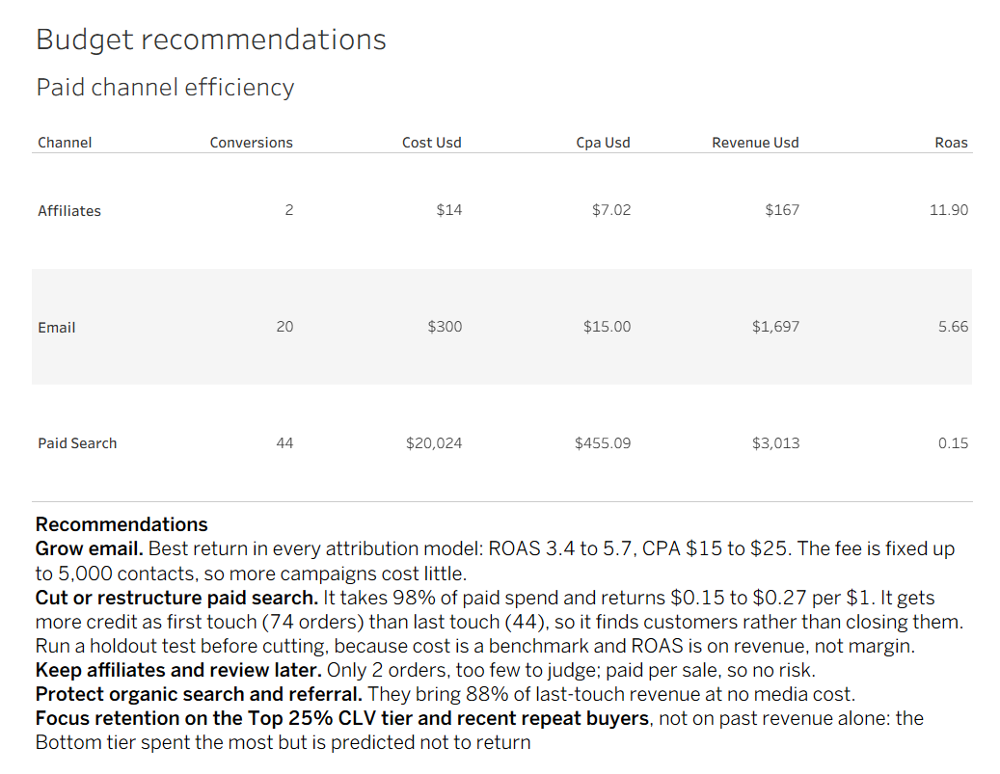
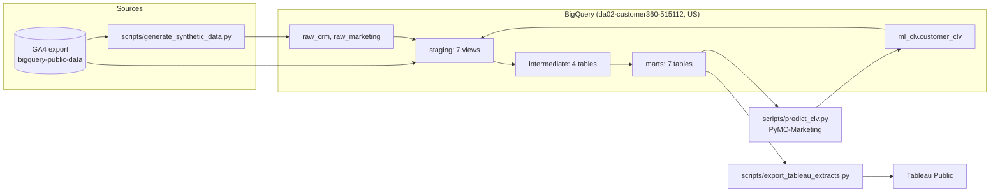
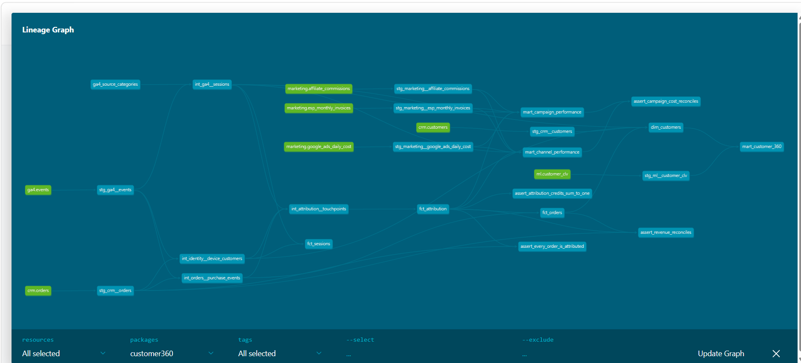

# Customer 360 and Marketing Attribution Platform

One view of each customer and of what each marketing channel really earns. Web behaviour from Google Analytics 4 is joined to CRM orders and channel costs in BigQuery, modelled with dbt, scored with Python, and shown in Tableau Public.

Source data: the Google Merchandise Store GA4 sample (`bigquery-public-data.ga4_obfuscated_sample_ecommerce`, 1 Nov 2020 to 31 Jan 2021), plus a CRM and channel cost reports generated from it (see [Data](#data)).

**Dashboard:** [Tableau Public](https://public.tableau.com/app/profile/sanju.sri.martha/viz/Customer360_Attribution/Marketingattribution)  
**Demo recording:** [watch on Google Drive](DEMO_VIDEO_URL)  
**Presentation:** [`docs/DA02_presentation.pdf`](docs/DA02_presentation.pdf) · **Reflection:** [`docs/reflection.md`](docs/reflection.md)  
**Author:** Sanju Sri Martha  
[](https://github.com/marthasanjusri-code/nexvia-da-projects/actions/workflows/da02-ci.yml)

---

## What it does

- **Identity resolution.** GA4 devices are linked to CRM customers only through a shared order number (deterministic matching). 3,713 devices resolve to 3,698 customers; 15 customers bought from two devices. A device can never belong to two customers (tested).
- **Sessions and channels.** 360,129 sessions, each with its traffic source, the GA4 default channel group (Google's own rules and source list) and, where identity resolution found one, its customer.
- **Customer 360.** One row per customer: devices, sessions, first channel, orders, revenue, RFM scores and segment, and predicted 12-month CLV with a CLV tier.
- **Attribution.** Every order's credit is shared across the customer's sessions in the 90 days before it, under four models: first touch, last touch, linear and time decay. Direct visits get credit only when the whole path is direct, as in GA4.
- **ROI and CPA.** Attributed revenue against cost for the three paid channels and their 9 campaigns: ROAS, ROI and cost per acquisition, under each model.
- **Tested.** 95 dbt tests, including revenue reconciliation to the cent in every attribution model and campaign costs reconciling to channel costs, plus a holdout validation of the CLV model. Every push is checked by GitHub Actions.

## Dashboards

Published on [Tableau Public](https://public.tableau.com/app/profile/sanju.sri.martha/viz/Customer360_Attribution/Marketingattribution); the workbook is also in [`tableau/Customer360_Attribution.twbx`](tableau/Customer360_Attribution.twbx).

| Dashboard | Shows |
|---|---|
| Marketing attribution | Revenue by channel under the model chosen in a dropdown, paid channel ROAS and CPA, and all four models side by side |
| Customer 360 | Customers, orders, repeat rate and revenue; customers and revenue by RFM segment; customers, past revenue, predicted 12-month CLV and probability alive by CLV tier |
| Budget recommendations | Paid channel efficiency with the five recommendations below |





## Architecture



| Layer | dbt models | Role |
|---|---|---|
| Sources | `ga4.events`, `crm.*`, `marketing.*`, `ml.customer_clv` | Read as they are; tested for keys and relationships |
| Staging (views) | `stg_ga4__events`, `stg_crm__customers`, `stg_crm__orders`, `stg_marketing__*` (3), `stg_ml__customer_clv` | Rename, cast, flatten GA4 event parameters. One model per source table |
| Intermediate (tables) | `int_ga4__sessions`, `int_identity__device_customers`, `int_orders__purchase_events`, `int_attribution__touchpoints` | Sessions and channels, identity resolution, order times, eligible touchpoints |
| Marts (tables) | `fct_sessions`, `fct_orders`, `fct_attribution`, `dim_customers`, `mart_customer_360`, `mart_channel_performance`, `mart_campaign_performance` | Sessions with customers, orders, Customer 360, attribution credits, channel and campaign ROI and CPA |

**Segment.** The brief lists Segment. In production, Segment (or a similar customer data platform) would collect events and resolve identities. Here the GA4 export plays the event role and `int_identity__device_customers` does the identity resolution with the same deterministic rule (decision D14).

dbt lineage, from sources through staging and intermediate to marts (`dbt docs generate`):



Full decisions with evidence: [`docs/design/decision_log.md`](docs/design/decision_log.md). Limitations: [`docs/design/limitations.md`](docs/design/limitations.md). Test results: [`docs/test_results.md`](docs/test_results.md).

## Data

| Data | Source | Rows |
|---|---|---|
| Web events | GA4 public sample, read in place | 4,295,584 events, 360,129 sessions |
| CRM orders | The real GA4 transactions, de-duplicated by transaction ID | 4,451 orders, $308,200 |
| CRM customers | Devices that share an order merged into one customer; names and emails are synthetic (Faker, `@example.com`) | 3,698 |
| Paid search cost | Real paid search sessions × $2.61 benchmark CPC | 92 days, $20,023.92 |
| Affiliate commission | Real affiliate orders × 8.4% benchmark commission | 2 orders, $14.03 |
| Email platform | Mailchimp Standard, $100 a month | 3 invoices, $300 |

The brief asks for a GA4 sample plus a synthetic CRM and ad spend. Every order, session and channel is real GA4 data; only customer attributes and costs are generated, and every cost uses a cited benchmark (D06, D07).

## Findings and budget recommendations

Last-touch figures unless stated; the dashboard shows all four models.

| Channel | Cost | Revenue (range across 4 models) | ROAS | CPA |
|---|---|---|---|---|
| Email | $300 | $1,016 – $1,697 | 3.39 – 5.66 | $15 – $25 |
| Affiliates | $14 | $23 – $167 | 1.64 – 11.90 | $7 – $14 |
| Paid Search | $20,024 | $3,013 – $5,491 | 0.15 – 0.27 | $271 – $455 |

**By campaign** (last touch; paid search and email monthly cost shared across campaigns by their sessions that month):

| Channel | Campaign | Orders | Revenue | Cost | ROAS | CPA |
|---|---|---|---|---|---|---|
| Email | blackfriday_v2 | 9 | $840 | $85.15 | 9.86 | $9.46 |
| Email | holiday_v1 | 2 | $291 | $25.76 | 11.30 | $12.88 |
| Email | holiday_v2 | 6 | $333 | $57.58 | 5.78 | $9.60 |
| Email | blackfriday_v1 | 2 | $155 | $32.45 | 4.78 | $16.22 |
| Email | newyear_v2 | 1 | $78 | $36.45 | 2.14 | $36.45 |
| Email | newyear_v1 | 0 | $0 | $62.62 | – | – |
| Affiliates | data share promo | 2 | $167 | $14.03 | 11.90 | $7.01 |
| Paid Search | `<other>` (name hidden in the sample) | 44 | $3,013 | $20,010.87 | 0.15 | $454.79 |

1. **Email is the most efficient paid channel** in every model. The platform fee is fixed up to 5,000 contacts, so more campaigns to the existing list add revenue at little extra cost. Recommendation: grow email activity first, led by the Black Friday and Holiday creatives; review the New Year campaigns, which converted least.
2. **Paid Search takes 98% of paid spend and returns $0.15 – $0.27 per $1.** It gets more credit under first touch (74 orders) than last touch (44), so it introduces customers more than it closes them. Recommendation: cut bids or pause the weakest campaigns and move budget to email, but first run a holdout test, because the cost is a 2024 benchmark rather than the store's real spend and ROAS here is on revenue, not margin.
3. **Affiliates:** only 2 orders, too few to judge. It is paid per sale, so it carries no risk; keep it and review with more data.
4. **Organic search and referral bring 88% of last-touch revenue at no media cost.** Protect them (search optimisation, referral partners), but they have no cost data, so no ROI is claimed.
5. **Customers:** 88% buy once. The CLV model expects most customers to be inactive, so retention offers should target the top CLV tier and recent repeat buyers.

## Repository layout

```
DA-02/
├── README.md
├── requirements.txt                Python packages (pip freeze)
├── scripts/
│   ├── generate_synthetic_data.py  loads raw_crm and raw_marketing into BigQuery
│   ├── predict_clv.py              CLV model, writes ml_clv.customer_clv
│   └── export_tableau_extracts.py  writes tableau/data/*.csv
├── customer360/                    dbt project
│   ├── dbt_project.yml, packages.yml, package-lock.yml
│   ├── macros/default_channel_grouping.sql
│   ├── seeds/ga4_source_categories.csv
│   ├── models/staging/ (ga4, crm, marketing, ml)
│   ├── models/intermediate/
│   ├── models/marts/ (core, marketing)
│   └── tests/                      4 singular tests
├── tableau/
│   ├── Customer360_Attribution.twbx
│   └── data/                       CSV extracts used by the workbook
└── docs/
    ├── design/decision_log.md, limitations.md
    ├── screenshots/                dashboards and dbt lineage
    ├── test_results.md
    ├── DA02_presentation.pdf
    └── reflection.md
```

## Setup and run

**Prerequisites:** a Google Cloud project with BigQuery (the free Sandbox is enough), the Google Cloud CLI, Python 3.14, and Tableau Public for the workbook.

Versions used: dbt-core 1.12.7, dbt-bigquery 1.12.4, pymc-marketing 1.5.0, Python 3.14.2.

1. **Sign in to Google Cloud** (no key files are used):
   ```
   gcloud auth application-default login
   ```
2. **Python environment**, from `DA-02`:
   ```
   python -m venv .venv
   .venv\Scripts\activate
   pip install -r requirements.txt
   ```
3. **dbt profile.** Create `~/.dbt/profiles.yml` (kept outside the repository):
   ```yaml
   customer360:
     target: dev
     outputs:
       dev:
         type: bigquery
         method: oauth
         project: <your-project-id>
         dataset: customer360_dev
         location: US
         threads: 4
   ```
   Set `PROJECT_ID` in the three scripts to the same project.
4. **Load raw data, build, score, export.** The CLV step sits between two dbt runs because the model reads the marts and dbt reads its output:
   ```
   python scripts\generate_synthetic_data.py
   cd customer360
   dbt deps
   dbt build --exclude tag:clv
   cd ..
   python scripts\predict_clv.py
   cd customer360
   dbt build --select tag:clv
   cd ..
   python scripts\export_tableau_extracts.py
   ```
   Expected: `dbt build --exclude tag:clv` PASS=100, `dbt build --select tag:clv` PASS=14.
5. **Tableau.** Open `tableau/Customer360_Attribution.twbx` in Tableau Public and choose Data → Refresh for each data source.

**Continuous integration.** `.github/workflows/da02-ci.yml` runs on every push that changes DA-02: it compiles the Python scripts and runs `dbt deps` and `dbt parse`, which checks every model, reference, test and YAML file without connecting to BigQuery, so no cloud credentials are stored in GitHub (D41).

The BigQuery Sandbox deletes tables after 60 days. Running step 4 again rebuilds everything; the generator uses a fixed seed, so the results are the same.
